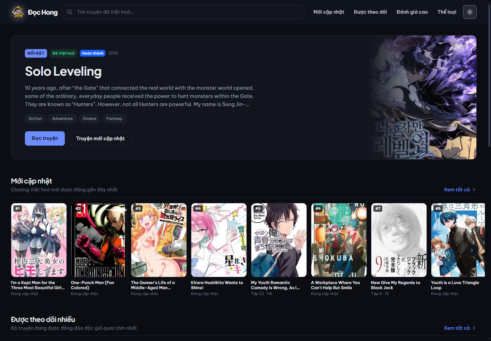
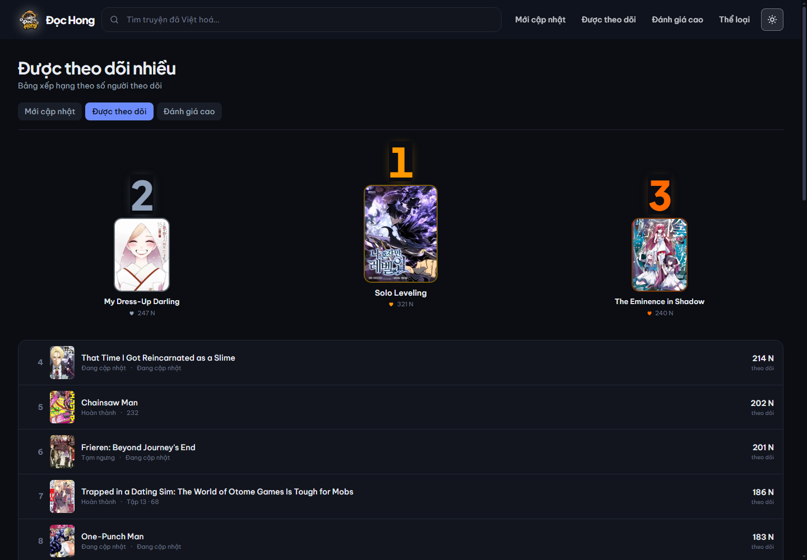
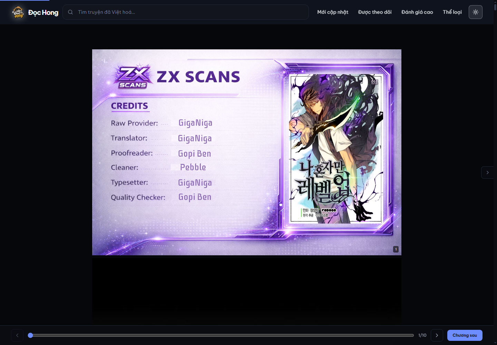
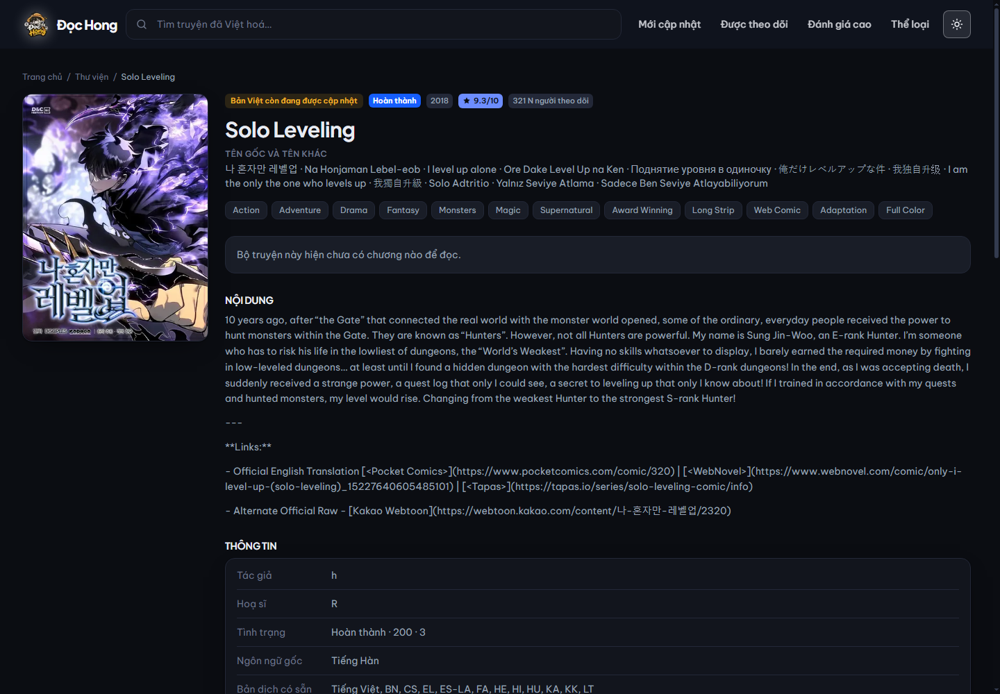
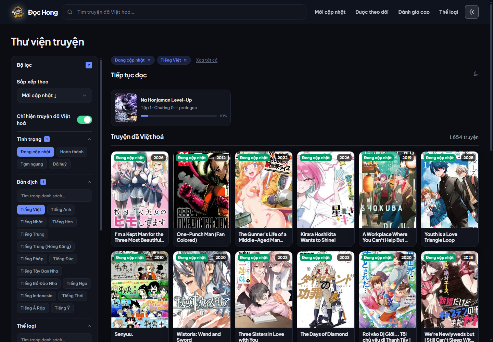
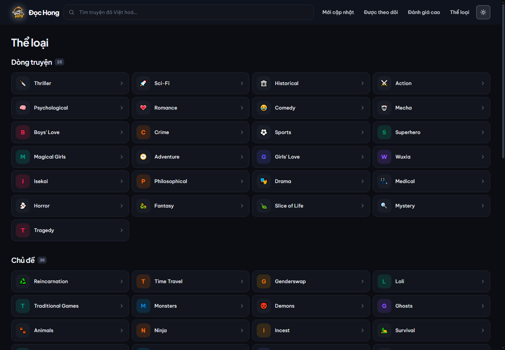
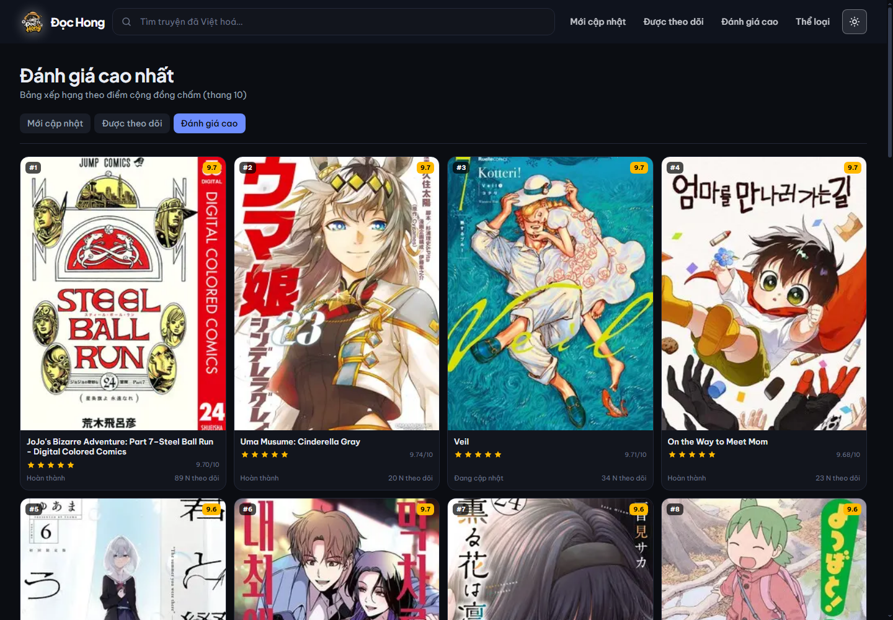
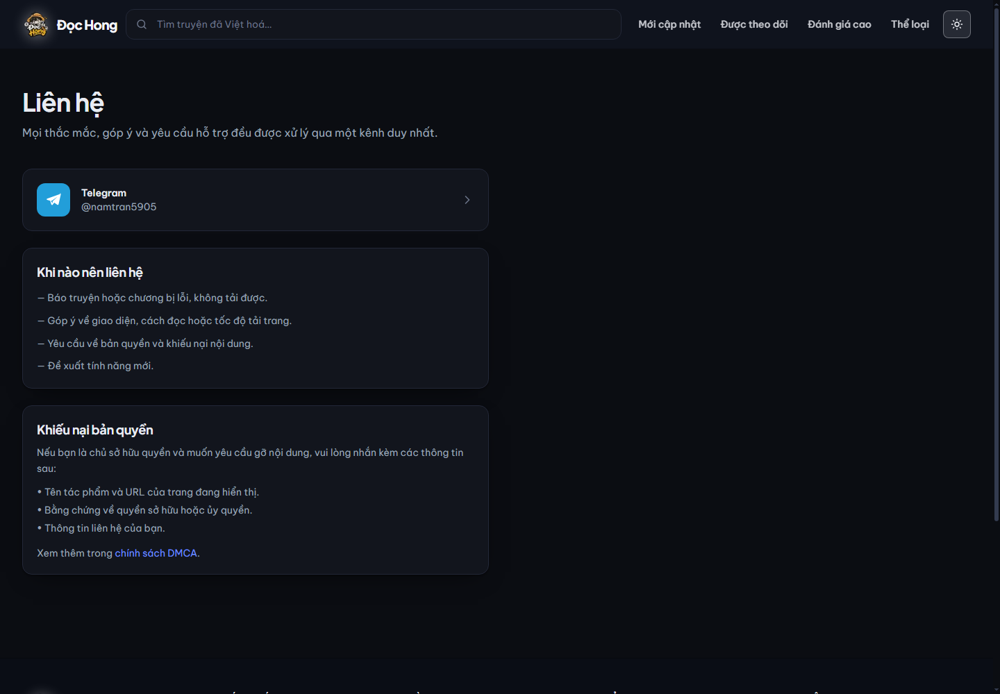
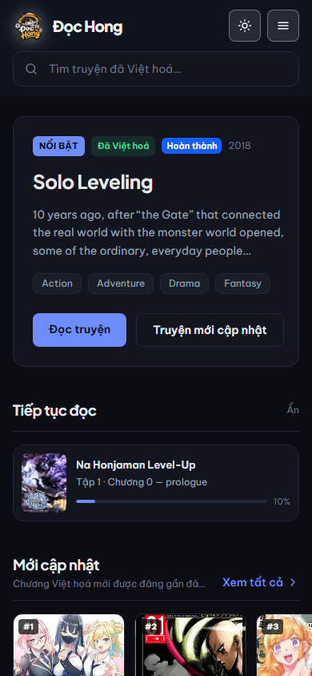
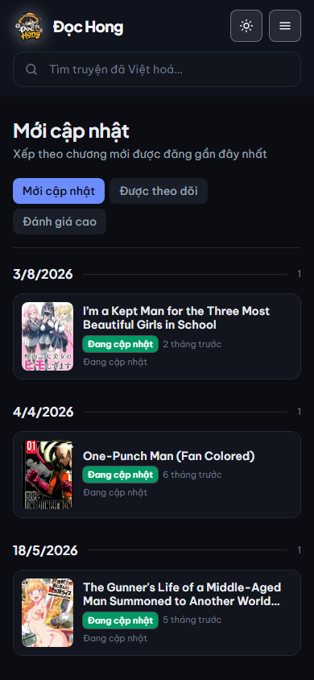

<div align="center">


# DocHong

**An online manga reader that prioritizes Vietnamese translations.**  
Built on MangaDex with a self-hosted proxy and cache.

[](#)
[](#)
[](#)
[](#)
[](#)
[](LICENSE)

**English** · [Tiếng Việt](README.vi.md)

</div>

---

## Screenshots

| Home | Rankings |
|:--:|:--:|
|  |  |

| Reader | Manga detail |
|:--:|:--:|
|  |  |

| Search with filters | Genre browser |
|:--:|:--:|
|  |  |

| Top rated | Contact |
|:--:|:--:|
|  |  |

<details>
<summary>More screenshots (mobile)</summary>

| Home | Reader | Search |
|:--:|:--:|:--:|
|  |  |  |

</details>

---

## Overview

DocHong is a two-part application:

- **`client/`** — the Next.js frontend the reader sees
- **`server/`** — a small Express proxy that talks to MangaDex

The proxy is **not optional**. MangaDex does not send CORS headers for third-party sites and forbids hotlinking its images, so every request — JSON and images — has to go through your own server.

```text
Browser  ──►  your server (proxy + cache)  ──►  api.mangadex.org
                                          ──►  MangaDex@Home (chapter images)
```

---

## Features

- **Vietnamese-first** — by default only shows manga that already have Vietnamese translations (`translatedLanguage[]=vi`)
- **Three home layouts** — timeline, ranked board and rating grid, switchable in the UI
- **Similar manga** — recommendations ranked by shared genres, tags and author
- **Reader** — continuous scroll or page-by-page, zoom, and a data-saver mode
- **Search with suggestions** — results appear as you type; press `Ctrl+K` to jump to the search box
- **Detailed filters** — genre, theme, status, translated language, demographic, publication year
- **Rankings** — top-rated and most-followed boards
- **Reading progress stored locally** — no account needed, nothing sent to the server

---

## Tech Stack

| Layer | Used |
|:--|:--|
| Frontend | Next.js 16 (App Router), React 19, Tailwind CSS 4, TypeScript 5 |
| Proxy | Node.js 20+, Express 5, helmet, cors, compression |
| Data | [MangaDex API](https://api.mangadex.org) |
| Build | npm workspaces, `concurrently`, `sharp` (logo generation) |

---

## Repository Layout

```text
.
├── client/                  # Next.js frontend
│   ├── src/app/             # Home, /truyen/[id], /doc/[chapterId], /tim-kiem, legal pages
│   ├── src/components/      # home, library, manga, reader, search, ui
│   └── src/lib/             # api.ts, library.ts, search-params.ts, site.ts, types.ts
├── server/                  # Express proxy
│   └── src/
│       ├── index.js         # App setup, CORS, mount points
│       ├── routes.js        # /api/* and /img/* routes
│       ├── config.js        # Env parsing, cache TTLs, content-rating policy
│       ├── mangadex.js      # Upstream client, rate limiting, error mapping
│       ├── reader.js        # MangaDex@Home page resolution
│       └── cover.js         # Cover image proxy
├── scripts/                 # Start, serve, precompress, release, screenshots
├── docs/                    # Screenshots and MangaDex API reference
└── package.json             # npm workspaces root
```

---

## Requirements

- **Node.js 20 or newer** (`engines` is enforced in the root `package.json`)
- **npm 10+**
- Internet access to `api.mangadex.org`
- Optional: **Microsoft Edge** or Chrome to run the screenshot / measurement scripts

---

## Getting Started

```bash
git clone https://github.com/Namtran592005/DocHong.git
cd DocHong

npm install
```

Create the server environment file:

```bash
# macOS / Linux
cp server/.env.example server/.env

# Windows (cmd)
copy server\.env.example server\.env

# Windows (PowerShell)
Copy-Item server\.env.example server\.env
```

Edit `server/.env` and **set a real user agent** before publishing — MangaDex requires it:

```env
MANGADEX_USER_AGENT=DocHong/1.0 (+https://your-domain.example/lien-he)
```

Start both processes with one command:

```bash
npm run dev
```

- Frontend: <http://localhost:3000>
- Proxy: <http://localhost:4000>

To run them separately:

```bash
npm run dev:server
npm run dev:client
```

---

## Configuration

### `server/.env`

| Variable | Default | Meaning |
|:--|:--|:--|
| `MANGADEX_BASE_URL` | `https://api.mangadex.org` | Upstream API. Do not change in production. |
| `MANGADEX_USER_AGENT` | `DocHong/1.0 (+https://example.com/lien-he)` | **Required by MangaDex policy.** Must contain an app name and a contact URL. The server warns at boot if it looks wrong. |
| `PORT` | `4000` | Proxy port. |
| `CORS_ORIGIN` | `http://localhost:3000` | Comma-separated list of allowed frontend origins. Only needed when the frontend and proxy run on different hosts. |
| `FORCE_PORT_443` | `false` | Force MangaDex@Home images over HTTPS port 443. |
| `CONTENT_RATING_MAX` | `suggestive` | Maximum content rating exposed: `safe` → `suggestive` → `erotica` → `pornographic`. Anything above this is filtered out server-side. |

### `client/.env`

Both variables are optional. Left empty, the site works on any domain.

| Variable | Default | Meaning |
|:--|:--|:--|
| `NEXT_PUBLIC_API_ORIGIN` | `http://localhost:4000` | Origin of the proxy. Only needed when it runs on a different host than the frontend. |
| `NEXT_PUBLIC_SITE_URL` | *(empty)* | Fixed origin for metadata and sitemap. Empty means derive it from the current request. |

---

## Proxy API

The Express server exposes two routers:

| Mount | Purpose |
|:--|:--|
| `/api/*` | JSON endpoints backed by MangaDex |
| `/img/*` | Image proxy (covers and chapter pages) |

### Endpoints

| Method | Path | Purpose |
|:--|:--|:--|
| `GET` | `/api/health` | Liveness plus cache stats |
| `GET` | `/api/config` | Effective config (max content rating, etc.) |
| `GET` | `/api/tags` | Genre / theme / demographic tag list |
| `GET` | `/api/manga` | Manga list with filters, sorting and pagination |
| `GET` | `/api/manga/random` | Random manga matching the filters |
| `GET` | `/api/manga/statistics` | Bulk statistics for a list of IDs |
| `GET` | `/api/manga/:id` | Manga detail |
| `GET` | `/api/manga/:id/feed` | Chapter feed |
| `GET` | `/api/manga/:id/aggregate` | Chapter list grouped into volumes |
| `GET` | `/api/manga/:id/similar` | Similar manga recommendations |
| `GET` | `/api/manga/:id/statistics` | Followers and rating |
| `GET` | `/api/chapter/:id` | Chapter metadata |
| `GET` | `/api/chapter/:id/pages` | Ordered image URLs for a chapter |
| `GET` | `/img/cover/:mangaId/:size/:fileName` | Proxied cover image |
| `GET` | `/img/chapter/:chapterId/:index` | Proxied chapter page image |

Errors are returned as JSON:

```json
{ "error": true, "code": "not_found", "message": "…" }
```

5xx responses use a generic message so upstream internals are never leaked to the browser.

### Caching and rate limiting

- In-memory TTL cache (max 3,000 entries) with **single-flight** de-duplication, so concurrent requests for the same resource only hit MangaDex once.

  | Data | TTL |
  |:--|:--|
  | Manga list | 5 min |
  | Manga detail | 10 min |
  | Chapter feed | 3 min |
  | Chapter aggregate | 10 min |
  | Chapter metadata | 10 min |
  | Recommendations | 30 min |
  | Statistics | 30 min |
  | Tag catalog | 1 h |
  | MangaDex@Home base URL | 5 min |

- Requests are spaced at least **220 ms apart** (`MDX_MIN_GAP_MS`), staying under MangaDex's roughly 5 requests/second/IP limit.

### Express 5 detail

MangaDex uses deep-object query parameters such as `translatedLanguage[]=vi`. Express 5's default query parser keeps the brackets literally, which would break language filtering, so the server sets:

```js
app.set('query parser', 'extended')
```

Keep this in mind if you refactor `server/src/index.js`.

---

## Production

```bash
npm run build        # next build + Brotli/gzip precompression
npm start            # runs proxy + frontend together
```

`npm start` uses `scripts/start.mjs`, which spawns both processes with the Node built-in API. It works with a production install (`npm ci --omit=dev`) because it does not depend on `concurrently` or `cross-env`.

Ports follow `PORT` for the proxy and the Next server (default `3000`). `scripts/serve.mjs` is a thin HTTP layer that serves precompressed `.br` / `.gz` files from `client/.next/static` with `Cache-Control: immutable`, then hands everything else to Next.

**Build a portable release bundle:**

```bash
npm run release      # npm run build + scripts/build-release.mjs → release/
```

The bundle contains the proxy source, the frontend build (with Brotli/gzip files), and only the runtime dependencies — no TypeScript, ESLint, `sharp` or screenshots.

---

## Scripts

| Command | What it does |
|:--|:--|
| `npm run dev` | Runs proxy and frontend together |
| `npm run dev:server` | Proxy only, with `--watch` |
| `npm run dev:client` | Next.js dev server on port 3000 |
| `npm run build` | Builds the frontend, then precompresses assets |
| `npm start` | Production: proxy + frontend |
| `npm run precompress` | Only runs the Brotli/gzip step |
| `npm run release` | Builds a deployable bundle into `release/` |
| `npm run logo` | Regenerates logo assets with `sharp` |
| `npm run screenshots` | Regenerates `docs/screenshots` |
| `npm run measure` | Measures page performance |
| `npm run check:images` | Checks lazy-loading behaviour against the viewport |

---

## Troubleshooting

| Symptom | Cause | Fix |
|:--|:--|:--|
| Covers and chapter images do not load | Proxy not running, or wrong `NEXT_PUBLIC_API_ORIGIN` | Check `http://localhost:4000/api/health` |
| `403` / `429` from MangaDex | Default or missing `MANGADEX_USER_AGENT`, or requests too fast | Set a real user agent with a contact URL; raise `MDX_MIN_GAP_MS` |
| Language filter has no effect | Express 5 query parser changed to a non-extended mode | Keep `app.set('query parser', 'extended')` |
| Manga you expect is missing | Filtered by `CONTENT_RATING_MAX` | Raise the value intentionally — it is a safety limit |
| Blank reader pages | MangaDex@Home node returned an expiry error | The proxy re-fetches the base URL; retry the page |

---

## Documentation

- [`docs/MangaDexAPIDocumentation.md`](docs/MangaDexAPIDocumentation.md) — MangaDex API reference

---

## License

The source code is released under the [MIT License](LICENSE).

This license **covers the project's source code only**. Manga data, translations and images belong to their authors, publishers and scanlation groups — they are not covered by MIT. DocHong only builds a reading interface. No ads, no paid service.

Copyright complaints: [@Namtran592005](https://github.com/Namtran592005)
