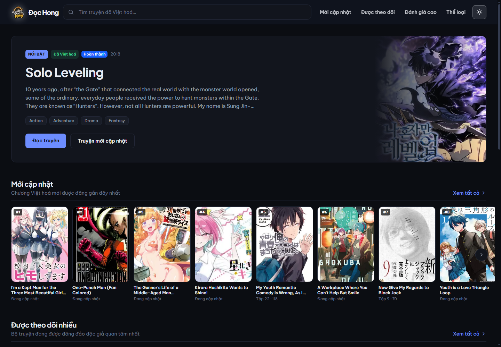
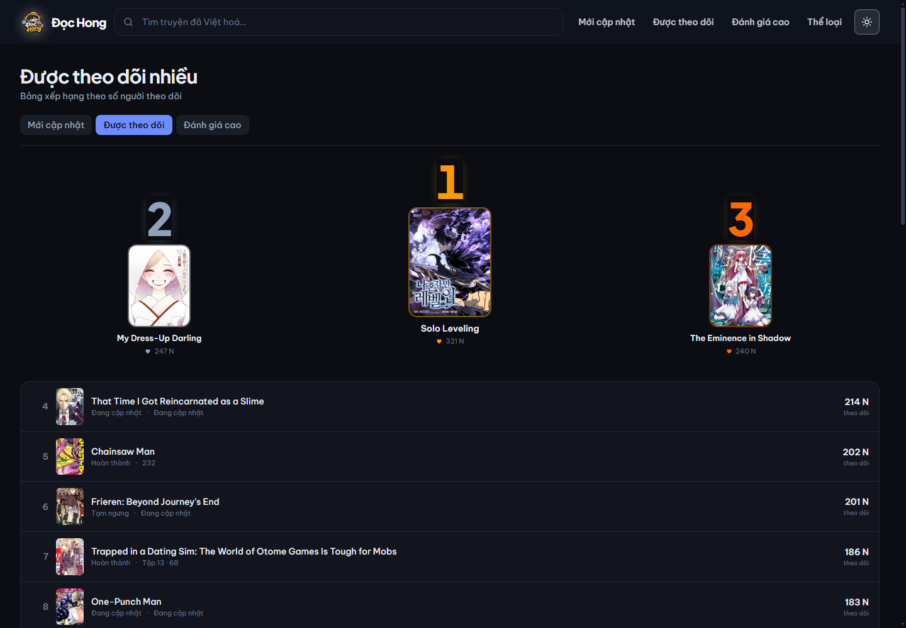
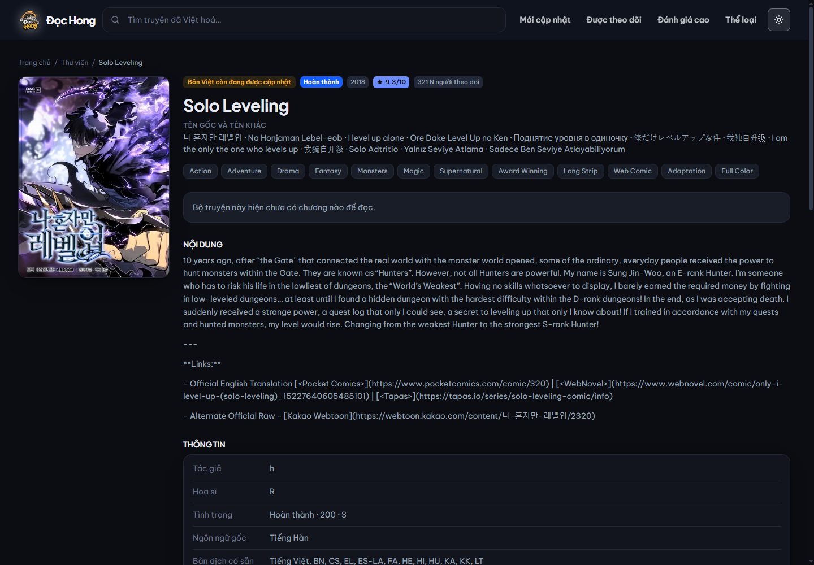
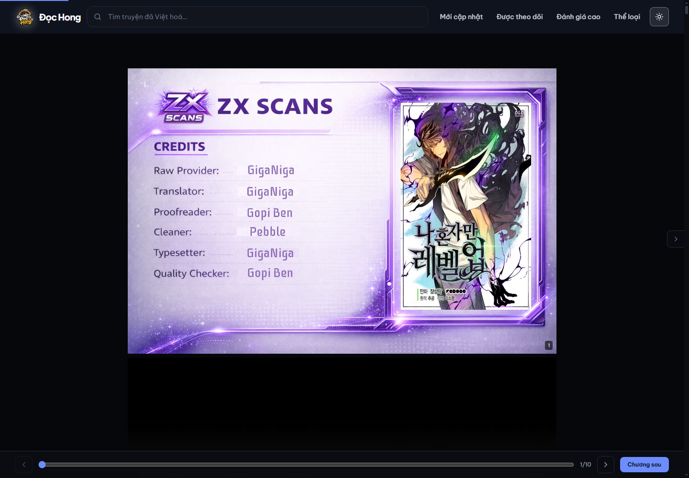
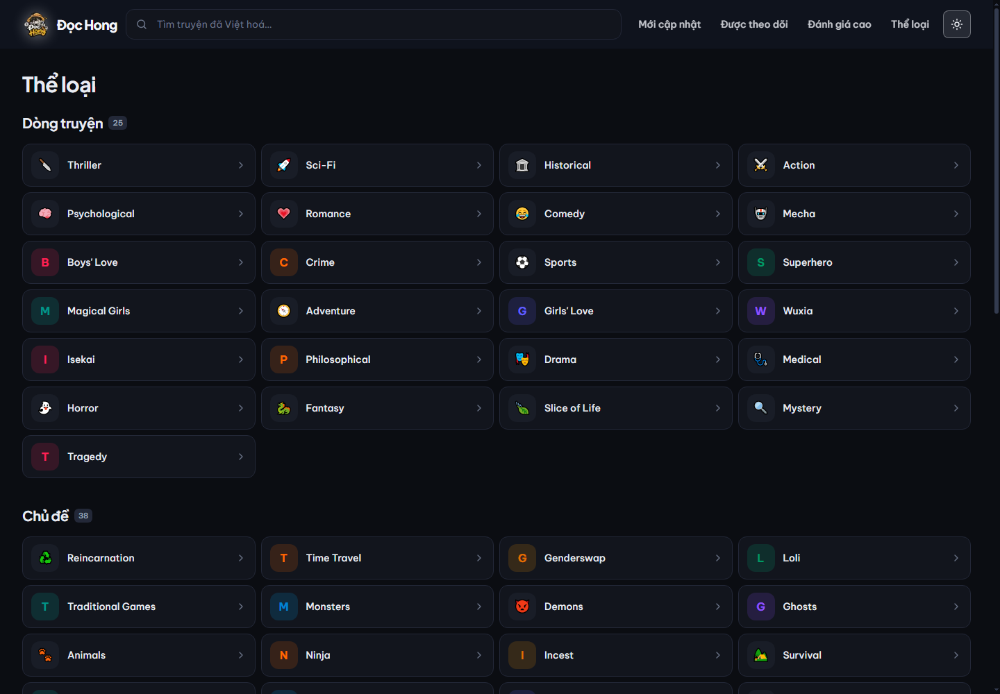
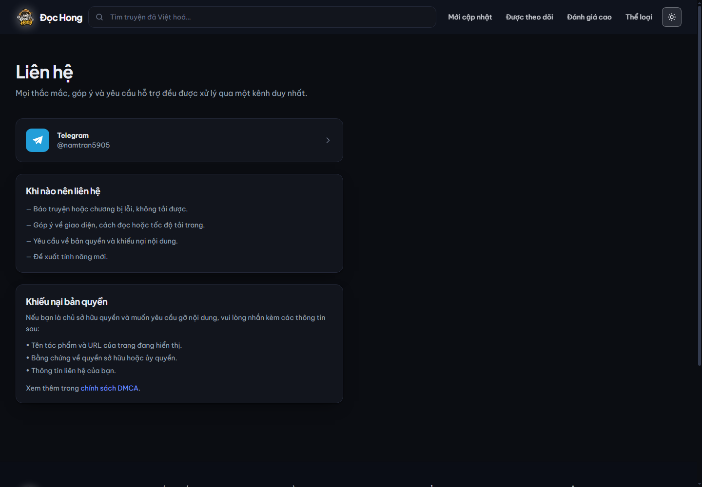
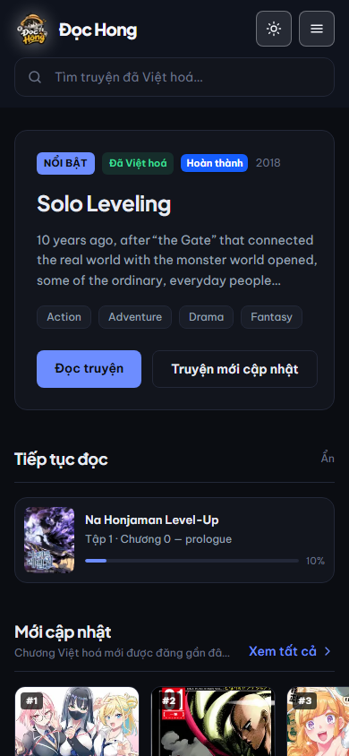
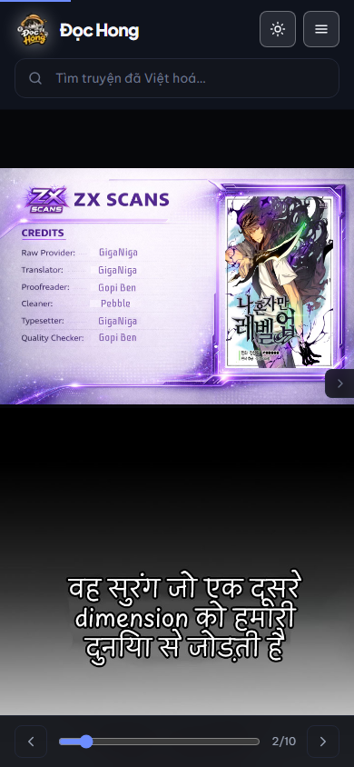

<p align="center">
  
</p>

<h1 align="center">Đọc Hong</h1>

<p align="center">
  Website đọc truyện trực tuyến, ưu tiên truyện đã có bản Việt hoá.
</p>

---

## Ảnh chụp

| Trang chủ | Bảng xếp hạng |
|---|---|
|  |  |

| Trang chi tiết | Trang đọc |
|---|---|
|  |  |

| Thể loại | Liên hệ |
|---|---|
|  |  |

<details>
<summary>Xem thêm (bản di động)</summary>

| Trang chủ | Trang đọc |
|---|---|
|  |  |

</details>

## Tính năng

- **Ưu tiên Việt hoá** — mặc định chỉ hiện truyện đã có bản dịch tiếng Việt, tắt được trong bộ lọc
- **Ba bố cục xếp hạng riêng** — dòng thời gian (mới cập nhật), bảng xếp hạng (được theo dõi), lưới thẻ điểm (đánh giá cao)
- **Gợi ý truyện cùng thể loại** — tự xếp hạng theo mức độ trùng thể loại
- **Trang đọc** — cuộn liên tục hoặc lật từng trang, thu phóng, chế độ tiết kiệm dữ liệu, bàn phím và vuốt tay
- **Tìm kiếm có đề xuất** — gõ là ra danh sách, `Ctrl+K` để nhảy vào ô tìm kiếm
- **Bộ lọc chi tiết** — thể loại, chủ đề, tình trạng, ngôn ngữ dịch, đối tượng, năm phát hành
- **Giao diện sáng và tối** — sáng dùng tông xanh dương, tối dùng nền than
- **Responsive** — bố cục riêng cho desktop, máy tính bảng và điện thoại
- **Tiến độ đọc lưu cục bộ** — không cần đăng nhập, không gửi dữ liệu lên máy chủ

## Công nghệ

| Phần | Dùng gì |
|---|---|
| Giao diện | Next.js 16 (App Router), React 19, Tailwind CSS 4, TypeScript |
| Máy chủ trung gian | Node.js 20+, Express 5 |
| Dữ liệu | API MangaDex |

## Vì sao cần máy chủ trung gian?

MangaDex **không trả CORS** cho website bên ngoài và **cấm hotlink ảnh** trực tiếp. Gọi API từ trình duyệt sẽ bị chặn, ảnh có thể trả sai nội dung. Vì vậy:

```text
Trình duyệt → máy chủ của bạn (proxy + cache) → api.mangadex.org
```

Máy chủ trung gian còn lo giới hạn 5 request/giây của MangaDex, cache dữ liệu, và giữ URL ảnh khỏi bị thu hồi.

## Chạy dự án

```bash
npm install

copy server\.env.example server\.env    # Windows
# cp server/.env.example server/.env     # macOS / Linux

npm run dev
```

Mở <http://localhost:3000>. Máy chủ trung gian chạy ở cổng 4000.

### Production

```bash
npm run build
npm start
```

Bản build **không phụ thuộc tên miền** — hệ thống tự lấy domain từ request cho metadata và sitemap, nên chạy được trên bất kỳ địa chỉ nào.

`npm run build` gồm hai bước: build Next.js rồi nén sẵn toàn bộ file tĩnh. `npm start` dùng `scripts/start.mjs`, không dùng `next start`.

## Đóng gói bản phát hành

```bash
npm run build
npm run release
```

Lệnh này tạo thư mục `release/` — bản chạy độc lập, chỉ chứa những gói phụ thuộc lúc chạy (không có TypeScript, ESLint, sharp hay ảnh chụp màn hình), kèm `HUONG-DAN.txt` hướng dẫn triển khai.

Bản đóng gói đã được kiểm tra bằng cách giải nén ra thư mục khác và chạy: 13/13 route trả đúng mã, proxy MangaDex và proxy ảnh hoạt động, Brotli vẫn được phục vụ.

## Nén dữ liệu

`next start` chỉ nén **gzip**. Phần lớn dung lượng lại nằm ở JavaScript, nên dự án tự nén sẵn hai định dạng rồi phục vụ theo yêu cầu của trình duyệt:

```text
/_next/static/**  →  .br nếu trình duyệt nhận Brotli
                  →  .gz nếu chỉ nhận gzip
                  →  bản gốc nếu không nhận kiểu nén nào
```

Kết quả đo trên bản build hiện tại:

| Tệp | Không nén | gzip | Brotli |
|---|---|---|---|
| 9 tệp JavaScript | 598,8 KB | 186,8 KB | **161,7 KB** |

Brotli nhỏ hơn gzip 13,4%. Phần HTML và ảnh vẫn do Next phục vụ (đã gzip sẵn, ảnh chuyển sang WebP).

Kiểm tra lại bất kỳ lúc nào:

```bash
npm run measure              # đo 3 trang mặc định
npm run measure /tim-kiem    # hoặc một đường dẫn cụ thể
```

> Nếu triển khai sau một reverse proxy (nginx, Caddy, Cloudflare), hãy bật nén ở đó và tắt `scripts/serve.mjs` — proxy sẽ làm việc này hiệu quả hơn.

## Cấu hình

Chỉ cần đặt `MANGADEX_USER_AGENT` trong `server/.env` trước khi phát hành:

```env
MANGADEX_USER_AGENT=DocHong/1.0 (+https://tenmiencuaban)
```

> MangaDex yêu cầu `User-Agent` thật kèm địa chỉ liên hệ.

Các biến khác xem trong `server/.env.example` và `client/.env.example`.

## Câu lệnh khác

```bash
npm run logo        # sinh lại bộ logo và icon từ docs/logo.webp
npm run screenshots # chụp lại ảnh trong docs/screenshots
npm run measure     # đo dung lượng tải về của từng trang
npm run precompress # nén lại file tĩnh (chạy tự động sau npm run build)
npm run release     # đóng gói bản phát hành vào thư mục release/
npm run check:images # ảnh nào đang tải trễ dù nằm trong khung nhìn
```

## Ảnh và khung nhìn đầu tiên

Ảnh nằm trong khung nhìn đầu phải tải ngay (`eager`), ảnh nằm dưới màn hình thì
tải trễ (`lazy`). Nếu đánh dấu lazy một ảnh đang hiện trước mắt, Edge sẽ hoãn
việc tải rồi thay bằng khung giữ chỗ, và báo:

```text
Intervention: Images loaded lazily and replaced with placeholders
```

Vì sao dùng `eager` chứ không dùng `priority`: `priority` sinh thêm
`<link rel="preload">`, nên ảnh nằm ngoài khung nhìn sẽ bị preload rồi không
dùng đến. `eager` chỉ tải ngay mà không preload — đúng thứ cần cho ảnh trên màn
hình đầu. `priority` chỉ dành cho ảnh bìa nổi bật.

Kiểm tra lại sau khi sửa giao diện:

```bash
npm run check:images            # trang chủ, khung nhìn 1440×1000
node scripts/check-lazy-viewport.mjs /tim-kiem 390 844   # trang khác, khung nhìn khác
```

Con số "tải trễ" phải bằng 0.

> Lưu ý: Edge chỉ hiện cảnh báo Intervention ở trình duyệt thật, không hiện ở
> chế độ headless — nên `npm run check:images` chỉ đo được nguyên nhân (ảnh lazy
> nằm trong khung nhìn), còn cảnh báo thì cần bạn tự mở Edge xác nhận.

## Giấy phép

Mã nguồn dùng giấy phép [MIT](LICENSE).

Giấy phép này **chỉ phủ mã nguồn của dự án**. Dữ liệu truyện, bản dịch và hình ảnh thuộc về tác giả, nhà xuất bản và các nhóm scanlation — không nằm trong phạm vi MIT. Dự án chỉ xây dựng giao diện đọc.

## Lưu ý bản quyền

Dữ liệu, bản dịch và hình ảnh thuộc về tác giả, nhà xuất bản và các nhóm scanlation. Website chỉ cung cấp giao diện đọc và ghi công nhận đầy đủ nguồn. Không quảng cáo, không dịch vụ trả phí — theo chính sách sử dụng API của MangaDex.

Khiếu nại bản quyền: <https://t.me/namtran5905>

## Tài liệu

- [`docs/MangaDexAPIDocumentation.md`](docs/MangaDexAPIDocumentation.md) — tài liệu API MangaDex
- [`docs/logo.webp`](docs/logo.webp) — logo gốc

## Phát triển

```bash
npm run dev
```

Trong lúc phát triển dùng `npm run dev` (Next.js tự xử lý nén), chỉ cần `scripts/serve.mjs` khi chạy production.