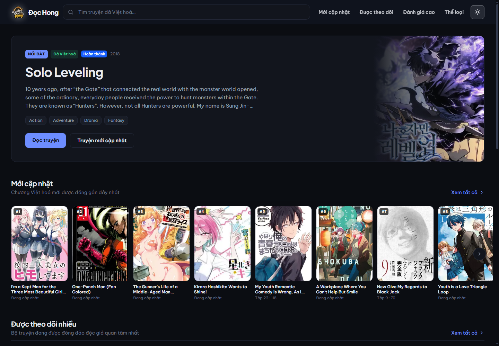
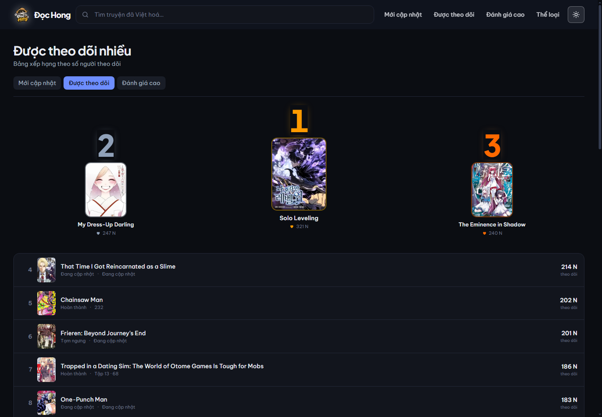
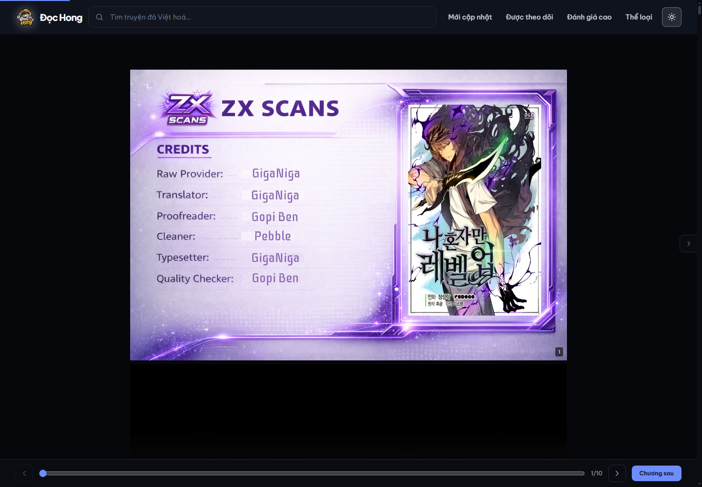
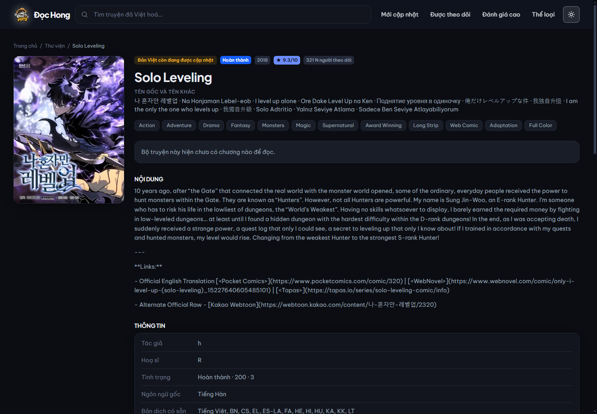
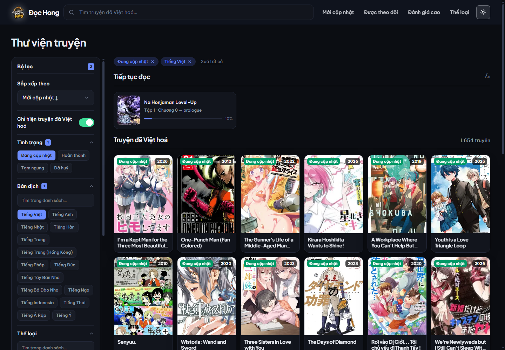
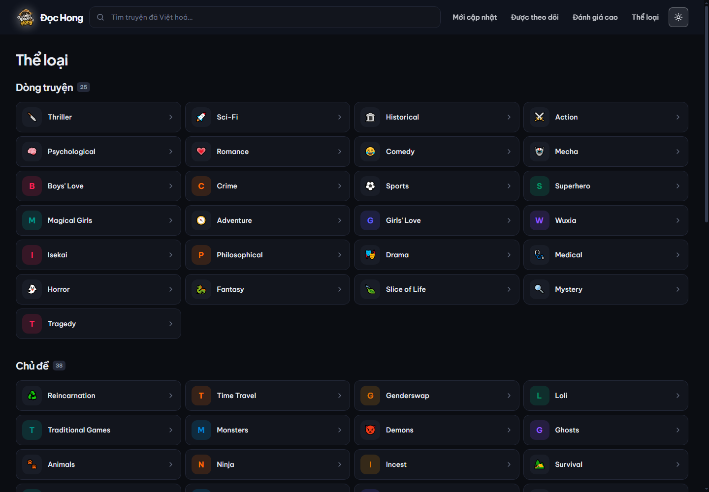
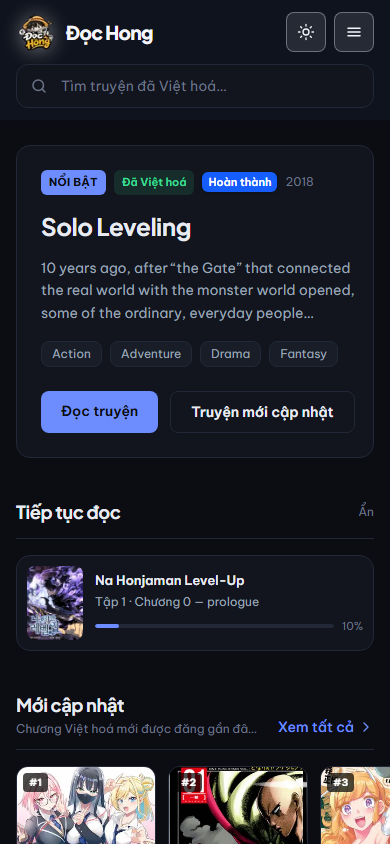
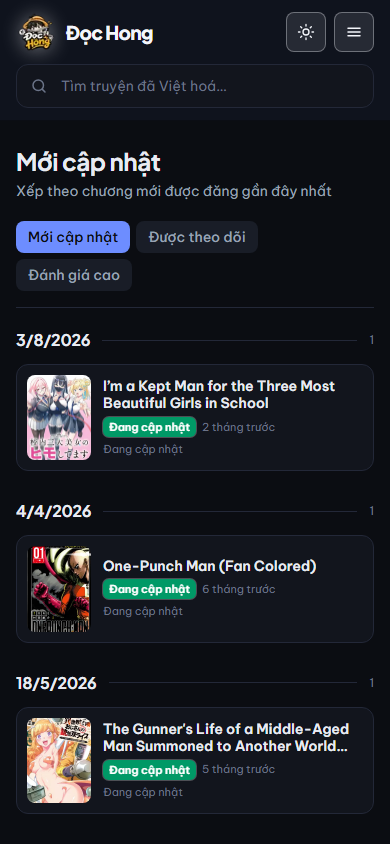

<div align="center">


# Đọc Hồng

**Website đọc truyện tranh trực tuyến, ưu tiên truyện đã có bản Việt hoá.**  
Xây dựng trên MangaDex với máy chủ proxy và cache tự dựng.

[](#)
[](#)
[](#)
[](#)
[](#)
[](LICENSE)

[English](README.md) · **Tiếng Việt**

</div>

---

## Ảnh chụp

| Trang chủ | Bảng xếp hạng |
|:--:|:--:|
|  |  |

| Trang đọc | Chi tiết truyện |
|:--:|:--:|
|  |  |

| Tìm kiếm có bộ lọc | Duyệt thể loại |
|:--:|:--:|
|  |  |

<details>
<summary>Xem thêm (bản di động)</summary>

| Trang chủ | Trang đọc | Tìm kiếm |
|:--:|:--:|:--:|
|  |  |  |

</details>

---

## Giới thiệu

DocHong gồm hai phần:

- **`client/`** — giao diện Next.js mà người đọc nhìn thấy
- **`server/`** — proxy Express nhỏ, giao tiếp với MangaDex

Proxy là **bắt buộc**, không phải tuỳ chọn. MangaDex không trả CORS cho website bên ngoài và cấm hotlink ảnh, nên mọi request — cả JSON lẫn ảnh — đều phải đi qua máy chủ của bạn.

```text
Trình duyệt  ──►  máy chủ của bạn (proxy + cache)  ──►  api.mangadex.org
                                                   ──►  MangaDex@Home (ảnh chương)
```

---

## Tính năng

- **Ưu tiên Việt hoá** — mặc định chỉ hiện truyện đã có bản dịch tiếng Việt (`translatedLanguage[]=vi`)
- **Ba bố cục xếp hạng** — dòng thời gian, bảng xếp hạng, lưới thẻ điểm; chuyển ngay trên giao diện
- **Gợi ý truyện cùng thể loại** — xếp hạng theo mức độ trùng thể loại, chủ đề và tác giả
- **Trang đọc** — cuộn liên tục hoặc lật từng trang, thu phóng, chế độ tiết kiệm dữ liệu
- **Tìm kiếm có gợi ý** — gõ là ra danh sách; nhấn `Ctrl+K` để nhảy vào ô tìm kiếm
- **Bộ lọc chi tiết** — thể loại, chủ đề, tình trạng, ngôn ngữ dịch, đối tượng, năm phát hành
- **Bảng xếp hạng** — điểm đánh giá cao và nhiều người theo dõi
- **Tiến độ đọc lưu cục bộ** — không cần đăng nhập, không gửi dữ liệu lên máy chủ

---

## Công nghệ

| Phần | Sử dụng |
|:--|:--|
| Giao diện | Next.js 16 (App Router), React 19, Tailwind CSS 4, TypeScript 5 |
| Proxy | Node.js 20+, Express 5, helmet, cors, compression |
| Dữ liệu | [API MangaDex](https://api.mangadex.org) |
| Build | npm workspaces, `concurrently`, `sharp` (tạo logo) |

---

## Cấu trúc repo

```text
.
├── client/                  # Giao diện Next.js
│   ├── src/app/             # Trang chủ, /truyen/[id], /doc/[chapterId], /tim-kiem, trang pháp lý
│   ├── src/components/      # home, library, manga, reader, search, ui
│   └── src/lib/             # api.ts, library.ts, search-params.ts, site.ts, types.ts
├── server/                  # Proxy Express
│   └── src/
│       ├── index.js         # Khởi tạo ứng dụng, CORS, mount router
│       ├── routes.js        # Các route /api/* và /img/*
│       ├── config.js        # Đọc env, TTL cache, chính sách content rating
│       ├── mangadex.js      # Client gọi API nguồn, giới hạn tốc độ, ánh xạ lỗi
│       ├── reader.js        # Phân giải ảnh chương qua MangaDex@Home
│       └── cover.js         # Proxy ảnh bìa
├── scripts/                 # Start, serve, precompress, release, screenshots
├── docs/                    # Ảnh chụp và tài liệu API MangaDex
└── package.json             # Gốc npm workspaces
```

---

## Yêu cầu

- **Node.js 20 trở lên** (`engines` được khai báo trong `package.json` gốc)
- **npm 10+**
- Kết nối Internet tới `api.mangadex.org`
- Tuỳ chọn: **Microsoft Edge** hoặc Chrome để chạy script chụp ảnh / đo hiệu năng

---

## Cài đặt và chạy

```bash
git clone https://github.com/Namtran592005/DocHong.git
cd DocHong

npm install
```

Tạo file môi trường cho proxy:

```bash
# macOS / Linux
cp server/.env.example server/.env

# Windows (cmd)
copy server\.env.example server\.env

# Windows (PowerShell)
Copy-Item server\.env.example server\.env
```

Sửa `server/.env` và **đặt user agent thật** trước khi phát hành — MangaDex bắt buộc:

```env
MANGADEX_USER_AGENT=DocHong/1.0 (+https://tenmiencuaban/lien-he)
```

Chạy cả hai tiến trình bằng một lệnh:

```bash
npm run dev
```

- Giao diện: <http://localhost:3000>
- Proxy: <http://localhost:4000>

Chạy riêng từng phần:

```bash
npm run dev:server
npm run dev:client
```

---

## Cấu hình

### `server/.env`

| Biến | Mặc định | Ý nghĩa |
|:--|:--|:--|
| `MANGADEX_BASE_URL` | `https://api.mangadex.org` | API nguồn. Không sửa ở production. |
| `MANGADEX_USER_AGENT` | `DocHong/1.0 (+https://example.com/lien-he)` | **Bắt buộc theo chính sách MangaDex.** Phải có tên ứng dụng và URL liên hệ. Server sẽ cảnh báo khi khởi động nếu giá trị không hợp lệ. |
| `PORT` | `4000` | Cổng của proxy. |
| `CORS_ORIGIN` | `http://localhost:3000` | Danh sách origin frontend được phép, phân tách bằng dấu phẩy. Chỉ cần khi frontend và proxy chạy khác host. |
| `FORCE_PORT_443` | `false` | Ép ảnh MangaDex@Home chạy qua HTTPS cổng 443. |
| `CONTENT_RATING_MAX` | `suggestive` | Mức nội dung tối đa được hiển thị: `safe` → `suggestive` → `erotica` → `pornographic`. Nội dung cao hơn bị lọc ngay phía server. |

### `client/.env`

Cả hai biến đều tuỳ chọn. Để trống thì website chạy được trên bất kỳ tên miền nào.

| Biến | Mặc định | Ý nghĩa |
|:--|:--|:--|
| `NEXT_PUBLIC_API_ORIGIN` | `http://localhost:4000` | Origin của proxy. Chỉ cần khi proxy nằm ở máy khác với frontend. |
| `NEXT_PUBLIC_SITE_URL` | *(trống)* | Tên miền cố định cho metadata và sitemap. Để trống thì tự lấy domain từ request hiện tại. |

---

## API của proxy

Server Express mở hai router:

| Đường dẫn gốc | Mục đích |
|:--|:--|
| `/api/*` | Endpoint JSON lấy từ MangaDex |
| `/img/*` | Proxy ảnh (bìa và trang truyện) |

### Danh sách endpoint

| Method | Đường dẫn | Mục đích |
|:--|:--|:--|
| `GET` | `/api/health` | Kiểm tra sống còn + thống kê cache |
| `GET` | `/api/config` | Cấu hình đang áp dụng (mức nội dung tối đa, ...) |
| `GET` | `/api/tags` | Danh sách thể loại / chủ đề / đối tượng |
| `GET` | `/api/manga` | Danh sách truyện có lọc, sắp xếp, phân trang |
| `GET` | `/api/manga/random` | Truyện ngẫu nhiên theo bộ lọc |
| `GET` | `/api/manga/statistics` | Thống kê hàng loạt theo danh sách ID |
| `GET` | `/api/manga/:id` | Chi tiết truyện |
| `GET` | `/api/manga/:id/feed` | Danh sách chương |
| `GET` | `/api/manga/:id/aggregate` | Danh sách chương gom theo tập |
| `GET` | `/api/manga/:id/similar` | Gợi ý truyện tương tự |
| `GET` | `/api/manga/:id/statistics` | Lượt theo dõi và điểm đánh giá |
| `GET` | `/api/chapter/:id` | Thông tin chương |
| `GET` | `/api/chapter/:id/pages` | Danh sách ảnh của chương theo thứ tự |
| `GET` | `/img/cover/:mangaId/:size/:fileName` | Proxy ảnh bìa |
| `GET` | `/img/chapter/:chapterId/:index` | Proxy ảnh trang truyện |

Lỗi trả về dạng JSON:

```json
{ "error": true, "code": "not_found", "message": "…" }
```

Response 5xx dùng thông báo chung để không lộ chi tiết nội bộ của API nguồn ra trình duyệt.

### Cache và giới hạn tốc độ

- Cache TTL trong bộ nhớ (tối đa 3.000 mục) có **single-flight**, nên nhiều request đồng thời cho cùng một tài nguyên chỉ gọi MangaDex một lần.

  | Dữ liệu | TTL |
  |:--|:--|
  | Danh sách truyện | 5 phút |
  | Chi tiết truyện | 10 phút |
  | Danh sách chương | 3 phút |
  | Chương gom theo tập | 10 phút |
  | Thông tin chương | 10 phút |
  | Gợi ý truyện | 30 phút |
  | Thống kê | 30 phút |
  | Danh mục tag | 1 giờ |
  | Base URL MangaDex@Home | 5 phút |

- Các request cách nhau tối thiểu **220 ms** (`MDX_MIN_GAP_MS`), nằm dưới giới hạn khoảng 5 request/giây/IP của MangaDex.

### Chi tiết về Express 5

MangaDex dùng tham số query dạng object lồng như `translatedLanguage[]=vi`. Parser mặc định của Express 5 giữ nguyên dấu ngoặc vuông trong tên tham số, khiến bộ lọc ngôn ngữ không hoạt động, nên server đặt:

```js
app.set('query parser', 'extended')
```

Cần lưu ý điểm này nếu refactor `server/src/index.js`.

---

## Chạy production

```bash
npm run build        # next build + nén sẵn Brotli/gzip
npm start            # chạy đồng thời proxy + frontend
```

`npm start` dùng `scripts/start.mjs`, script tự spawn cả hai tiến trình bằng API có sẵn của Node. Nó chạy được với bản cài production (`npm ci --omit=dev`) vì không phụ thuộc `concurrently` hay `cross-env`.

Cổng của proxy theo `PORT`, Next server mặc định `3000`. `scripts/serve.mjs` là lớp HTTP mỏng: phục vụ file `.br` / `.gz` đã nén sẵn trong `client/.next/static` với `Cache-Control: immutable`, rồi chuyển mọi yêu cầu còn lại cho Next.

**Đóng gói bản phát hành di động:**

```bash
npm run release      # npm run build + scripts/build-release.mjs → release/
```

Bản này chứa mã nguồn proxy, bản build giao diện (kèm file nén Brotli/gzip) và chỉ những gói phụ thuộc cần lúc chạy — không kèm TypeScript, ESLint, `sharp` hay ảnh chụp màn hình.

---

## Các lệnh

| Lệnh | Chức năng |
|:--|:--|
| `npm run dev` | Chạy cả proxy và frontend |
| `npm run dev:server` | Chỉ proxy, có `--watch` |
| `npm run dev:client` | Next.js dev server ở cổng 3000 |
| `npm run build` | Build frontend rồi nén sẵn tài nguyên |
| `npm start` | Production: proxy + frontend |
| `npm run precompress` | Chỉ chạy bước nén Brotli/gzip |
| `npm run release` | Tạo gói triển khai trong `release/` |
| `npm run logo` | Tạo lại bộ logo bằng `sharp` |
| `npm run screenshots` | Chụp lại `docs/screenshots` |
| `npm run measure` | Đo hiệu năng trang |
| `npm run check:images` | Kiểm tra hành vi lazy-load theo viewport |

---

## Xử lý sự cố

| Hiện tượng | Nguyên nhân | Cách khắc phục |
|:--|:--|:--|
| Ảnh bìa và ảnh truyện không tải được | Proxy chưa chạy, hoặc `NEXT_PUBLIC_API_ORIGIN` sai | Kiểm tra `http://localhost:4000/api/health` |
| MangaDex trả `403` / `429` | Thiếu hoặc dùng `MANGADEX_USER_AGENT` mặc định; gửi request quá nhanh | Đặt user agent thật kèm URL liên hệ; tăng `MDX_MIN_GAP_MS` |
| Bộ lọc ngôn ngữ không có tác dụng | Query parser của Express 5 bị đổi sang chế độ không mở rộng | Giữ `app.set('query parser', 'extended')` |
| Không thấy truyện mình cần | Bị lọc bởi `CONTENT_RATING_MAX` | Cân nhắc nâng giá trị — đây là giới hạn an toàn |
| Trang đọc trắng | Node MangaDex@Home trả lỗi hết hạn | Proxy tự lấy lại base URL; tải lại trang |

---

## Tài liệu

- [`docs/MangaDexAPIDocumentation.md`](docs/MangaDexAPIDocumentation.md) — tài liệu API MangaDex

---

## Giấy phép và bản quyền

Mã nguồn dùng giấy phép [MIT](LICENSE).

Giấy phép này **chỉ phủ mã nguồn của dự án**. Dữ liệu truyện, bản dịch và hình ảnh thuộc về tác giả, nhà xuất bản và các nhóm scanlation — không nằm trong phạm vi MIT. DocHong chỉ xây dựng giao diện đọc. Không quảng cáo, không dịch vụ trả phí.

Khiếu nại bản quyền: <https://t.me/namtran5905>
